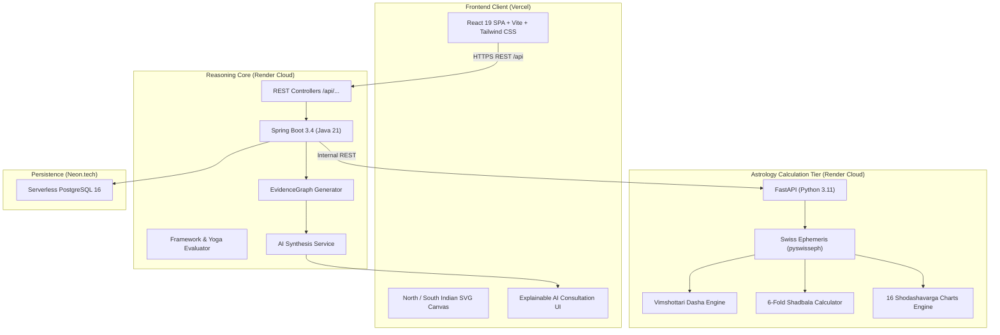

# Astro-AI 🪐✨
### Enterprise Deterministic Vedic Astrology (Jyotish) & Explainable AI Kundli Platform

[](https://astro-ai-tau-blue.vercel.app/)
[](https://astro-ai-backend-lkjp.onrender.com/api/locations/search?query=Delhi)
[](https://astro-ai-engine.onrender.com/health)
[](https://opensource.org/licenses/MIT)

[](https://react.dev/)
[](https://www.typescriptlang.org/)
[](https://tailwindcss.com/)
[](https://adoptium.net/)
[](https://spring.io/projects/spring-boot)
[](https://www.python.org/)
[](https://www.astro.com/swisseph/)
[](https://neon.tech/)

---

## 🌐 Live Production Deployments

| Component | Provider | Live URL | Status |
| :--- | :--- | :--- | :--- |
| **Frontend Web App** | Vercel | [**https://astro-ai-tau-blue.vercel.app/**](https://astro-ai-tau-blue.vercel.app/) |  |
| **Reasoning Core API** | Render Cloud | [**https://astro-ai-backend-lkjp.onrender.com/api**](https://astro-ai-backend-lkjp.onrender.com/api/locations/search?query=Delhi) |  |
| **Astrology Calculation Engine** | Render Cloud | [**https://astro-ai-engine.onrender.com**](https://astro-ai-engine.onrender.com/health) |  |
| **Serverless Database** | Neon.tech | PostgreSQL 16 (SSL enabled) |  |

> **Note on Render Free Tier**: Backend containers spin down after 15 minutes of inactivity. When loading the app after idle periods, a friendly wake-up banner guides you while cold boots complete in ~30–45 seconds.

---

## ⚡ The Core Philosophy: Deterministic Astrological Computation First

> **"The LLM is NEVER the astrology calculation engine."**

Generic AI models frequently hallucinate planetary longitudes, misassign Nakshatra Padas, and invent erroneous Dasha periods. **Astro-AI** guarantees 100% mathematical accuracy by decomposing the problem into three decoupled tiers:

1. **Deterministic Calculation Tier (`astrology-engine`)**:
   - High-precision ephemeris calculations via the industry-standard **Swiss Ephemeris (`pyswisseph`)** with **Lahiri Ayanamsha** (Chitra Paksha).
   - Computes exact planetary longitudes, speeds, retrograde markers (`[R]`), combustion states (`[C]`), 27 Nakshatras & 108 Padas, and 16 Shodashavarga charts.
2. **Domain Reasoning Tier (`backend`)**:
   - Enterprise Spring Boot 3 core that processes astrological entities into a formal **`EvidenceGraph`** (`SUPPORTING | CHALLENGING | NEUTRAL`).
   - Evaluates classical Parashari rules, 6-fold Shadbala strengths, Bhava Balas, Yoga conditions, and Vimshottari timing windows.
3. **Explainable AI Synthesis Tier (`AIService`)**:
   - Consumes the pre-computed `EvidenceGraph` to synthesize natural-language astrological consultations.
   - Every claim is tied to an explicit mathematical proof exposed via the interactive **"Why This Answer?"** inspector.

---

## 🌟 Key Features

### 1. Interactive Kundli Charts (North & South Indian Formats)
- **North Indian (Diamond / Diamond-House Style)** and **South Indian (Fixed-Zodiac Box Style)** visualizers with real-time toggle.
- Displays Ascendant (Lagna), planetary placements, retrograde signs, combust indicators, and house numbers.
- Instant responsive rendering with zero lag.

### 2. High-Precision Janma Nakshatra & Pada Identification
- Full **27 Nakshatra** matrix mapped to all **108 Padas** (3°20' arc intervals).
- Accurately distinguishes **Ascendant Nakshatra (Udaya Lagna)** from **Birth Star (Janma Nakshatra / Chandra Lagna)**.
- Shows nakshatra lord, pada number, ruling deity, and element (tatva).

### 3. Shodashavarga (16 Divisional Charts)
- Complete coverage of classical Parashara divisional charts:
  - **D1 (Rashi)** — Physical incarnation, core vitality, and overall life foundation.
  - **D9 (Navamsha)** — Dharmic trajectory, marriage, spiritual inclinations, and true planetary dignity.
  - **D2 (Hora)**, **D3 (Drekkana)**, **D4 (Chaturthamsha)**, **D7 (Saptamsha)**, **D10 (Dashamsha / Career)**, **D12 (Dwadashamsha)**, **D16 (Shodashamsha)**, **D20 (Vimshamsha)**, **D24 (Chaturvimshamsha)**, **D27 (Saptavimshamsha)**, **D30 (Trimshamsha)**, **D40 (Khavedamsha)**, **D45 (Akshavedamsha)**, **D60 (Shashtiamsha)**.

### 4. 5-Level Vimshottari Dasha Engine
- Full 120-year cycle computed with microsecond astronomical precision:
  $$\text{Mahadasha} \longrightarrow \text{Antardasha} \longrightarrow \text{Pratyantardasha} \longrightarrow \text{Sookshma} \longrightarrow \text{Prana}$$
- Current active dasha highlighted with exact start and end timestamps.

### 5. Classical 6-Fold Shadbala & Bhava Bala
- Quantitative planetary potency measurement based on *Brihat Parashara Hora Shastra* (BPHS):
  - **Sthana Bala** (Positional strength: Uccha, Saptavargiya, Ojhayugma, Kendradi, Drekkana)
  - **Dig Bala** (Directional strength in directional houses)
  - **Kala Bala** (Temporal strength: Natonnatha, Paksha, Tribhaga, Varsha/Masa/Dina/Hora)
  - **Chesta Bala** (Motional strength / Retrogradation)
  - **Naisargika Bala** (Natural luminosity strength)
  - **Drik Bala** (Aspectual strength)
- Calculated in **Virupas** and normalized to **Rupas** with requirement ratios.

### 6. Classical Yoga Detection Engine
- Scans the chart for hundreds of classical combinations:
  - **Pancha Mahapurusha Yogas**: Ruchaka (Mars), Bhadra (Mercury), Hamsa (Jupiter), Malavya (Venus), Sasa (Saturn).
  - **Raja Yogas**: Kendra-Trikona lord associations and mutual exchanges (Parivartana).
  - **Dhana Yogas**: Wealth combinations between 1st, 2nd, 5th, 9th, and 11th lords.
  - **Special Yogas**: Gajakesari, Budhaditya, Neechabhanga Raja Yoga, Viparita Raja Yogas (Harsha, Sarala, Vimala).

### 7. Sarvashtakavarga (SAV) & Bhinnashtakavarga (BAV)
- Complete 337-bindu distribution matrix across all 12 bhavas and 7 grahas.
- Identifies strong vs. challenging life sectors (wealth, career, health, relationships).

### 8. Explainable AI Astrological Consultation
- Interactive AI chat powered by strict deterministic grounding.
- **Trace Inspector ("Why This Answer?")**: Inspect the raw evidence graph, supporting planetary positions, transits, and dasha timings that justified the AI's conclusions.

---

## 🏗️ System Architecture



---

## 📁 Repository Structure

```text
astro-ai/
├── frontend/                     # React 19 + TypeScript + Vite + Tailwind CSS
│   ├── src/
│   │   ├── components/           # Kundli Charts, Dashas, Shadbala, AI Chat
│   │   ├── services/             # Axios API client & endpoints
│   │   ├── types/                # Complete TypeScript AST & API interfaces
│   │   └── App.tsx               # Main dashboard with progressive rendering
│   ├── index.html                # SEO meta, OpenGraph tags & cosmic favicon
│   └── vite.config.ts
├── backend/                      # Spring Boot 3.4 + Java 21 REST API
│   ├── src/main/java/com/astroai/
│   │   ├── client/               # Engine REST client & URL normalizer
│   │   ├── kundli/               # Chart generation & coordinate mapping
│   │   ├── dasha/                # Vimshottari dasha hierarchy
│   │   ├── strength/             # Shadbala & Bhava Bala processing
│   │   ├── yoga/                 # Parashari Yoga detection algorithms
│   │   ├── evidence/             # EvidenceGraph construction
│   │   └── reasoning/            # Explainable AI trace synthesis
│   └── pom.xml                   # Maven dependencies
├── astrology-engine/             # Python 3.11 + FastAPI + Swiss Ephemeris
│   ├── app/
│   │   ├── calculations/         # Planetary longitudes, Nakshatras & Padas
│   │   ├── charts/               # D1-D60 Divisional charts calculation
│   │   ├── dasha/                # Exact 120-year Vimshottari math
│   │   └── shadbala/             # Classical 6-fold planetary strength
│   ├── Dockerfile
│   └── requirements.txt
├── docs/                         # Comprehensive architectural specifications
│   ├── ARCHITECTURE.md           # Deep-dive system design
│   ├── ASTROLOGY_SPECIFICATION.md # Parashari astrological rules & math
│   └── FREE_CLOUD_DEPLOYMENT.md  # 24/7 zero-cost cloud deployment guide
├── render.yaml                   # Infrastructure-as-code blueprint for Render
└── docker-compose.yml            # Local multi-container development environment
```

---

## 🚀 Quickstart & Local Development

### Prerequisites
- **Node.js** >= 20.x
- **Java JDK** >= 21
- **Maven** >= 3.9
- **Python** >= 3.11
- **Docker & Docker Compose** (optional)

### 1. Run Everything via Docker Compose (Recommended)
```bash
git clone https://github.com/RanjanRajPandey/astro-ai.git
cd astro-ai
docker compose up --build
```
- Frontend: `http://localhost:5173`
- Backend API: `http://localhost:8080/api`
- Ephemeris Engine: `http://localhost:8000`

---

### 2. Manual Local Setup

#### Step A: Start the Astrology Calculation Engine
```bash
cd astrology-engine
python -m venv .venv
# Windows
.venv\Scripts\activate
# macOS/Linux
source .venv/bin/activate

pip install -r requirements.txt
uvicorn app.main:app --host 0.0.0.0 --port 8000 --reload
```
Test health: `curl http://localhost:8000/health` -> `{"status":"ok"}`

#### Step B: Start the Spring Boot Backend
```bash
cd ../backend
# Set environment variables for local testing
export SPRING_DATASOURCE_URL="jdbc:postgresql://localhost:5432/astro_ai"
export SPRING_DATASOURCE_USERNAME="postgres"
export SPRING_DATASOURCE_PASSWORD="password"
export ASTRO_ENGINE_URL="http://localhost:8000"

mvn spring-boot:run
```

#### Step C: Start the React Frontend
```bash
cd ../frontend
npm install
npm run dev
```
Open [http://localhost:5173](http://localhost:5173) in your browser!

---

## 📡 REST API Reference

All requests accept UTC dates or local dates with explicit timezones.

| Method | Endpoint | Description |
| :--- | :--- | :--- |
| `POST` | `/api/charts/kundli` | Computes Ascendant, planetary positions, D1 Rashi chart, and Nakshatra Padas |
| `POST` | `/api/divisional/calculate` | Computes Shodashavarga charts (D1, D9, D10, etc.) |
| `POST` | `/api/dashas/vimshottari` | Calculates 5-level Vimshottari Dasha sequence from birth |
| `POST` | `/api/strength/shadbala` | Computes 6-fold Shadbala & Bhava Bala planetary strengths |
| `POST` | `/api/yogas/detect` | Identifies active classical Parashari Yogas |
| `POST` | `/api/transits/calculate` | Computes dynamic Gochara (transits) against natal positions |
| `POST` | `/api/evidence/generate` | Builds structured `EvidenceGraph` with supporting & challenging factors |
| `POST` | `/api/ai/chat` | Queries the AI reasoning layer with full explainability trace |
| `GET`  | `/api/locations/search?query={city}` | Built-in offline gazetteer for latitude, longitude, and timezone lookup |

---

## 🛡️ License

This project is licensed under the **MIT License** — see the [LICENSE](LICENSE) file for details.

---

<p align="center">
  <b>Astro-AI</b> — Bridging Ancient Vedic Wisdom with Modern Engineering Precision.<br>
  Built with ❤️ for Astrologers, Researchers, and Engineers worldwide.
</p>
